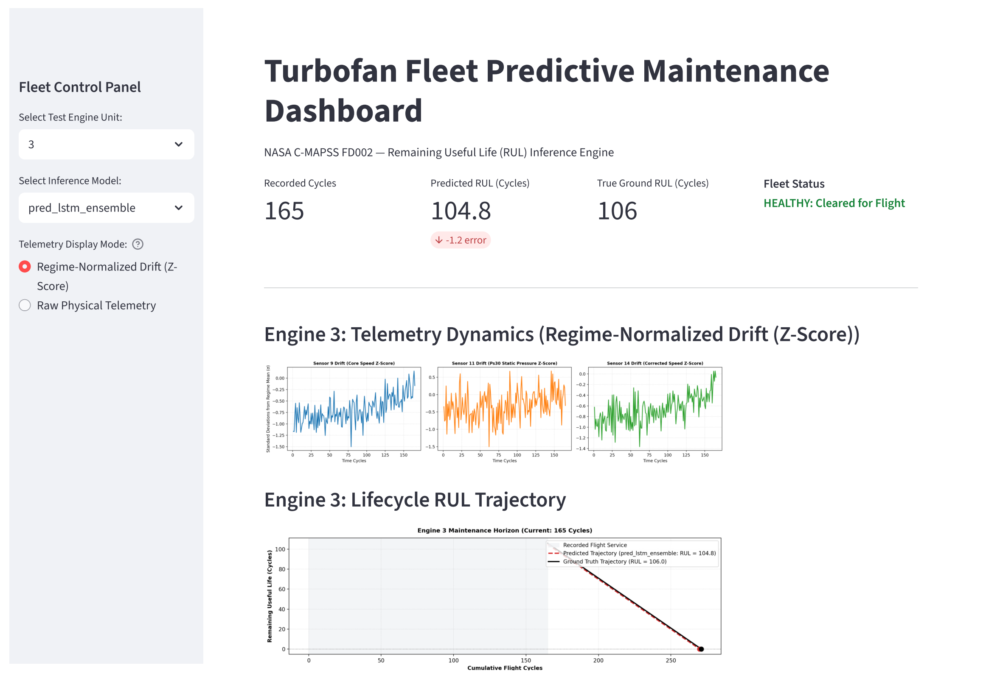

# Turbofan Engine Remaining Useful Life (RUL) Prognostics
### Degradation Modeling  across NASA C-MAPSS FD001 & FD002


---

## 1. Executive Summary & Operational Impact

In commercial and defense aviation, equipment prognostic health management (PHM) directly balances flight safety against lifecycle operating costs. An inaccurate overestimation of Remaining Useful Life ($RUL$) can result in in-flight engine shutdowns (IFSD) and catastrophic structural failures. Conversely, premature maintenance pulls on healthy engines waste engine flight hours and inflate shop-visit expenditures.

This project delivers an end-to-end predictive maintenance system developed on the **NASA Commercial Modular Aero-Propulsion System Simulation (C-MAPSS)** datasets. The system benchmarks classical gradient-boosted trees against deep recurrent sequence architectures, addressing both steady-state environments and complex, multi-condition flight envelopes:

* **FD001 (Single Operating Regime):** 100 training engines run to failure; 100 test engines truncated prior to failure. Steady-state, sea-level operating environment where sensor variance is driven purely by high-pressure compressor degradation.
* **FD002 (Multi-Regime Operating Envelope):** 260 training engines; 259 test engines. Simulates 6 discrete flight regimes varying simultaneously in altitude ($0\text{ to }42\times 10^3\text{ ft}$), Mach number ($0.0\text{ to }0.84\text{ Mach}$), and Throttle Resolver Angle ($60\text{ to }100^\circ\text{ TRA}$). Flight transitions induce macro-level sensor shifts of up to $\pm 110^\circ\text{R}$, masking subtle mechanical degradation trends.

To address the multi-regime challenge in FD002, an unsupervised **$K$-Means clustering ($k=6$)** pipeline establishes regime-specific baselines to extract leak-free $Z$-score degradation anomalies. Continuous regression predictions are evaluated using symmetric metrics ($RMSE$, $MAE$), the asymmetric **NASA Operational Penalty Function**, and an operational **3-Tier Triage Decision Matrix** (Critical, Warning, Nominal).

---

## 2. Methodology & System Architecture

```
Raw Telemetry Data (Altitude, Mach, TRA, 21 Sensors)
                          │
         ┌────────────────┴────────────────┐
         ▼                                 ▼
   FD001 Pipeline                    FD002 Pipeline
(Single Sea-Level Regime)       (6 Flight Regimes Switching)
         │                                 │
Prune 7 Invariant Sensors        Unsupervised K-Means (k=6)
(Zero-Variance Channels)        on Flight Envelope Controls
         │                                 │
Global MinMax Scaling           Leak-Free Regime Baseline Mapping
                                [μ_(sensor, r), σ_(sensor, r) from Train]
                                           │
                                Regime Z-Score Normalization
         │                                 │
         └────────────────┬────────────────┘
                          ▼
            Target Engineering (Piecewise RUL)
               [Clipped at RUL_max = 125 cycles]
                          │
         ┌────────────────┴────────────────┐
         ▼                                 ▼
Tabular Pipeline (Tree Baselines)   Sequence Pipeline (Deep Learning)
Rolling Windows (w = 5, 10, 15, 30)  Sliding Window Tensors (N x 30 x C)
[Mean, Std, Min, Max Features]       Time-Series Memory Tracking
         │                                 │
         └────────────────┬────────────────┘
                          ▼
        5-Fold GroupKFold Cross-Validation (Grouped by Engine Unit)
                          ▼
         Model Benchmarking (Ridge, RF, XGBoost, LightGBM, 1D-CNN, LSTM)
                          │
         ┌────────────────┴────────────────┐
         ▼                                 ▼
  Operational Evaluation            Interactive Deployment
3-Tier Safety Confusion Matrix       Streamlit Fleet Monitoring Engine
(Critical, Warning, Nominal)         (Telemetry Drift & Failure Horizon)
```

### Unsupervised Regime Disentanglement (FD002)
To decouple operational flight dynamics from physical component wear in FD002:
1. $K$-Means clustering ($k=6$) partitions the continuous operational space defined by `setting_1` (Altitude), `setting_2` (Mach), and `setting_3` (TRA).
2. Intra-regime baseline mean ($\mu_{\text{train}, r}$) and standard deviation ($\sigma_{\text{train}, r}$) vectors are computed strictly on the training fleet.
3. Test telemetry is projected into the nearest cluster centroid and normalized against the fixed training parameters:
   $$z_{i, r} = \frac{x_{i, r} - \mu_{\text{train}, r}}{\sigma_{\text{train}, r}}$$
This normalization collapses operating-condition variance from $>100^\circ\text{R}$ down to an interquartile range of $<2^\circ\text{R}$, revealing monotonic degradation slopes.

### Target Engineering & Piecewise Formulation
Turbofan degradation follows an initial period of negligible wear followed by exponential mechanical deterioration. A linear target overestimates early degradation; therefore, the regression target is modeled as a piecewise linear function:
$$RUL_t = \min(RUL_{\text{actual}, t}, RUL_{\max}), \quad \text{where } RUL_{\max} = 125\text{ cycles}$$

### Leakage-Free Validation Protocol
Random $K$-fold cross-validation causes temporal and inter-engine data leakage. All models are trained using **5-Fold `GroupKFold`**, ensuring that complete engine lifecycles (`unit_nr`) are strictly isolated within either training or validation folds.

---

## 3. Evaluation Metrics

### Symmetric Error Metrics
* **Root Mean Squared Error ($RMSE$):** Penalizes larger estimation errors quadratically.
  $$RMSE = \sqrt{\frac{1}{N} \sum_{i=1}^{N} (\hat{y}_i - y_i)^2}$$
* **Mean Absolute Error ($MAE$):** Measures average absolute deviation in cycles.
  $$MAE = \frac{1}{N} \sum_{i=1}^{N} |\hat{y}_i - y_i|$$

### Asymmetric NASA Operational Scoring Function
In aviation prognostics, under-predicting $RUL$ (early pull) leads to manageable scheduling overhead, whereas over-predicting $RUL$ (late pull) risks uncontained failure. The official NASA PHM scoring function penalizes late predictions exponentially:
$$d_i = \hat{y}_i - y_i$$
$$S = \sum_{i=1}^{N} s_i, \quad \text{where } s_i = \begin{cases} \exp\left(-\frac{d_i}{13}\right) - 1 & \text{for } d_i < 0 \text{ (Conservative / Early)} \\ \exp\left(\frac{d_i}{10}\right) - 1 & \text{for } d_i \ge 0 \text{ (Optimistic / Late / High Risk)} \end{cases}$$

---

## 4. Benchmark Leaderboard & Results

### FD002 Test Set Performance (259 Test Engines)

| Model Architecture | Feature Representation | Test RMSE (Cycles) | Test MAE (Cycles) | NASA Penalty Score | Triage Accuracy |
| :--- | :--- | :---: | :---: | :---: | :---: |
| **Stacked LSTM (5-Fold Ensemble)** | 3D Temporal Tensors ($N \times 30 \times 16$) | **13.33** | **9.53** | **845.8** | **91.1%** |
| **1D-CNN (5-Fold Ensemble)** | 3D Temporal Tensors ($N \times 30 \times 16$) | 14.98 | 11.22 | 1009.3 | 89.6% |
| **LightGBM Regressor** | Hand-Crafted Rolling Summary ($113\text{ feats}$) | 15.89 | 11.70 | 1532.2 | 87.6% |
| **XGBoost Regressor** | Hand-Crafted Rolling Summary ($113\text{ feats}$) | 15.93 | 11.77 | 1507.0 | 87.3% |
| **Random Forest Regressor** | Hand-Crafted Rolling Summary ($113\text{ feats}$) | 16.00 | 12.01 | 1532.3 | 86.9% |
| **Ridge Regression** | Scaled Snapshot Baseline | 18.42 | 14.15 | 1680.8 | 83.4% |

**Key Finding:** Deep sequence architectures significantly outperformed tree-based models on multi-regime dynamics. The Stacked LSTM achieved a **2.56-cycle reduction in RMSE** over LightGBM and reduced the asymmetric NASA penalty score by **44.8%** ($845.8$ vs. $1532.2$), demonstrating superior tracking of late-life degradation curvature.

---

## 5. Operational Decision Matrix (3-Tier Triage)

To directly support maintenance logistics, continuous predictions are mapped to operational tiers:
1. **Critical ($\le 20$ Cycles):** Immediate grounding for depot inspection and teardown.
2. **Warning ($21\text{ to }60$ Cycles):** Flag for scheduled maintenance; order replacement LRUs.
3. **Nominal ($>60$ Cycles):** Cleared for standard flight operations.

### Confusion Matrix Comparison (FD002 Test Fleet, $N=259$)


<!-- ```
          LightGBM (87.6% Accuracy)                      Stacked LSTM (91.1% Accuracy)
                Predicted Tier                                 Predicted Tier
            Critical  Warning  Nominal                     Critical  Warning  Nominal
          ┌─────────┬─────────┬─────────┐                ┌─────────┬─────────┬─────────┐
Critical  │   43    │   10    │    0    │      Critical  │   46    │    7    │    0    │
          ├─────────┼─────────┼─────────┤                ├─────────┼─────────┼─────────┤
Warning   │    2    │   34    │   13    │      Warning   │    3    │   37    │    9    │
          ├─────────┼─────────┼─────────┤                ├─────────┼─────────┼─────────┤
Nominal   │    0    │    7    │   150   │      Nominal   │    0    │    4    │   153   │
          └─────────┴─────────┴─────────┘                └─────────┴─────────┴─────────┘
``` -->

### Operational Highlights
* **Zero Catastrophic Escapes:** Both models achieved a clean $0$ in the upper-right corner—**zero critical engines were misclassified as nominal**.
* **Higher Critical Detection:** The Stacked LSTM increased critical class recall from **$81.1\%$ to $86.8\%$**, capturing $46$ of $53$ engines requiring immediate maintenance and reducing critical delays from $10$ to $7$.
* **Reduced False Alarms:** False maintenance alarms in the healthy Nominal tier were reduced from $7$ down to $4$, while warning units erroneously cleared as nominal dropped from $13$ down to $9$.


---

## 6. Interactive Fleet Management Dashboard

The deployment layer provides a dual-dataset Streamlit dashboard that visualizes model inferences alongside real-time engine telemetry:

* **Engine Unit & Model Selector:** Select any test unit across the fleet and compare inferences across classical and deep learning models.
* **Telemetry Display Mode Toggle:**
  * *Raw Physical Telemetry:* View raw engineering units ($^\circ\text{R}$, $\text{psia}$, $\text{rpm}$) showing operational flight envelopes.
  * *Regime-Normalized Drift ($Z$-Score):* View real-time component degradation trends with flight envelope variations removed.
* **Failure Horizon Trajectory Curve:** Projects recorded flight history against the predicted wear trajectory to zero cycles versus ground truth.

### Launching the Dashboard Locally

```bash
# Clone the repository
git clone https://github.com/AISaleheen/RUL_NASA_C-MAPSS_DATA.git
cd RUL_NASA_C-MAPSS_DATA

# Create and activate environment
conda create -n turbofan-phm python=3.10 -y
conda activate turbofan-phm

# Install dependencies
pip install -r requirements.txt

# Run the FD002 Fleet Health Dashboard
cd app
streamlit run app_FD002_v2.py
```

*(To run the FD001 application, execute `streamlit run app_FD001.py` from the `app/` directory).*

---

## 7. Repository Structure

```text
RUL_NASA_C-MAPSS_DATA/
├── data/                               # Dataset and export artifact directory
│   ├── test_FD001.txt                  # Raw FD001 test telemetry
│   ├── RUL_FD001.txt                   # Ground-truth RUL for FD001
│   ├── test_FD002.txt                  # Raw FD002 test telemetry
│   ├── RUL_FD002.txt                   # Ground-truth RUL for FD002
│   ├── test_predictions_FD001.csv     # Model inference exports (FD001)
│   ├── test_predictions_FD002.csv     # Model inference exports (FD002)
│   └── test_features_FD002.csv        # Regime-normalized feature exports
├── notebook/                           # Development and benchmark workflows
│   ├── FD001.ipynb                     # Steady-state sea-level pipeline
│   └── FD002.ipynb                     # Multi-regime K-Means & deep sequence pipeline
├── app/                                # Production deployment layer
│   ├── app_FD001.py                    # Streamlit dashboard for FD001
│   └── app_FD002_v2.py                    # Streamlit dashboard for FD002
├── requirements.txt                    # Project dependencies
└── README.md                           # Technical documentation and reporting
```

---

## 8. Authors & Acknowledgments
* **Dataset Attribution:** A. Saxena, K. Goebel, D. Simon, and N. Eklund, *"Damage Propagation Modeling for Aircraft Engine Run-to-Failure Simulation"*, Prognostics and Health Management (PHM08), Denver CO, 2008. NASA Ames Research Center.
* Developed as an advanced predictive maintenance portfolio project.